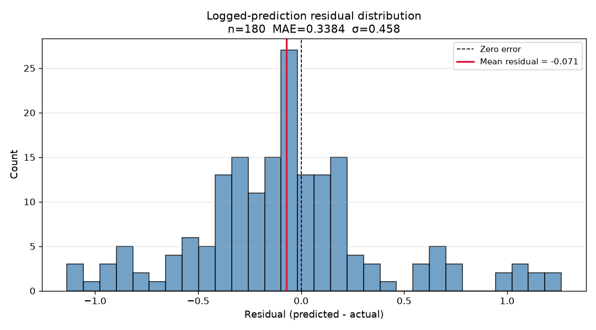
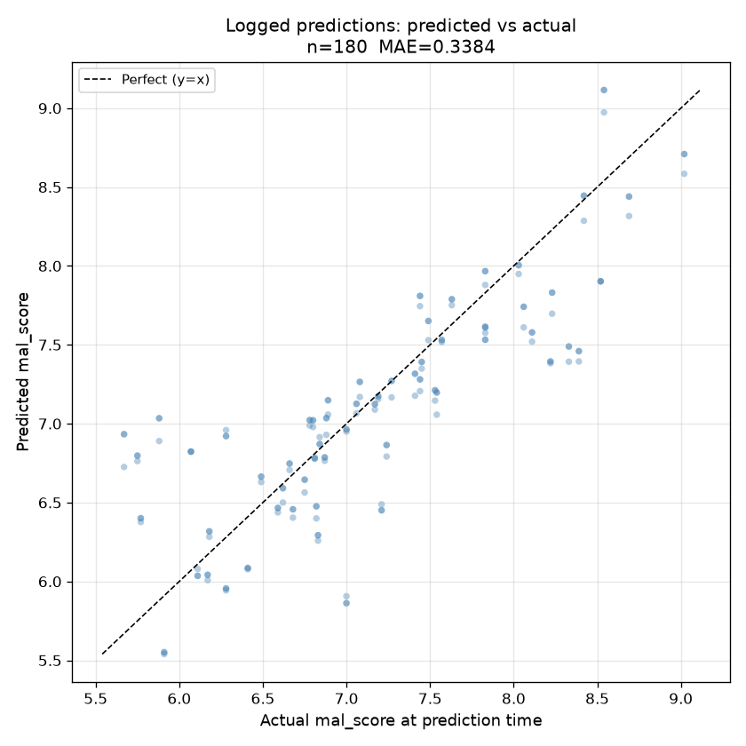

# Hype Predictor Health Report

**Status: [OK] healthy**  
**Generated:** `2026-11-01T12:19:18.033737+00:00`  
**Rolling window:** last 30 days

## Current committed model

- **Version:** `lin-20261101-71e7db-v5324`
- **Algorithm:** LinearRegression
- **Trained:** 2026-11-01
- **Training sample:** 5,324 shows
- **Test MAE at train time (baseline):** 0.4358
- **Signal lift vs predict-mean:** 25.6%

## Drift thresholds

| Threshold | Rolling MAE value | Meaning |
|-----------|-------------------|---------|
| Warning (baseline x 1.10) | 0.4794 | Monitor closely |
| Alert (baseline x 1.20) | 0.5230 | Open issue, consider retrain |

## Rolling-window health

- **Rolling MAE:** 0.3384
- **Rolling RMSE:** 0.4620
- **Drift from baseline:** -22.3%

## Prediction log stats

- **Total rows:** 183
- **Distinct model versions:** 1

## Per-model-version breakdown

| Version | Predictions | Resolved | Rolling MAE | Status |
|---------|-------------|----------|-------------|--------|
| `lin-20261011-f7568c-v5324` | 183 | 180 | 0.3384 | [OK] |

## Visualizations

---

This report is regenerated monthly by `.github/workflows/monthly-hype-retrain.yml`. Source: `tools/report_prediction_health.py`.